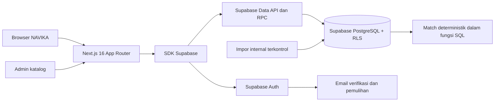
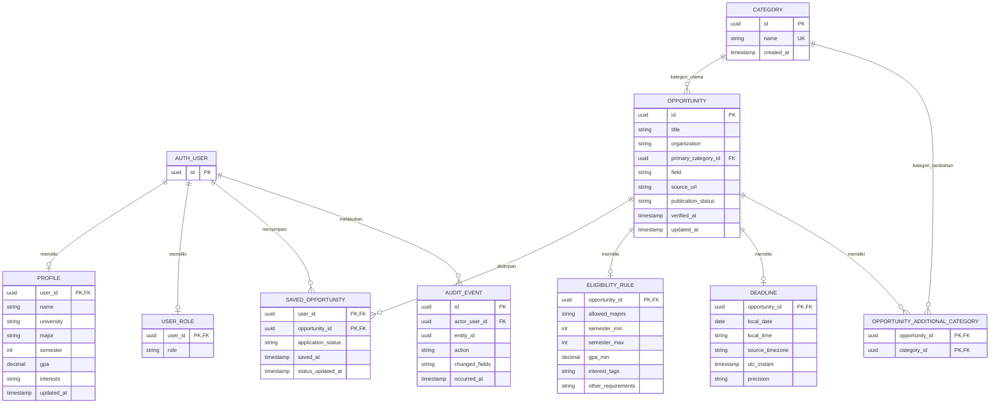

# PRD Backend NAVIKA

Status: draf kebutuhan backend MVP. Dokumen ini mendampingi `PRD-NAVIKA.md`. Semua target kinerja di bawah adalah kriteria rilis yang diusulkan, bukan hasil pengukuran aplikasi saat ini.

## 1. Executive Summary

### 1.1 Problem Statement

Aplikasi Next.js NAVIKA saat ini masih memakai login demo, profil dan bookmark di `localStorage`, katalog dalam `script/opportunities.js`, serta deadline contoh yang dihitung dari `demoDays`. Pengguna belum memiliki akun dan data pribadi yang persisten lintas perangkat; tim juga belum memiliki satu sumber data peluang yang dapat diaudit.

### 1.2 Proposed Solution

Bangun backend memakai Supabase PostgreSQL sebagai sumber data utama dan Supabase Auth untuk identitas, verifikasi email, pemulihan akses, dan sesi. Aplikasi Next.js 16 mengakses data melalui Supabase Data API dan fungsi PostgreSQL (RPC) dengan kebijakan Row Level Security (RLS). Backend menyediakan kategori dan katalog yang dikelola admin, profil, Finder, Match deterministik, bookmark, tracker, serta kalender. Pendaftaran peluang tetap berlangsung di situs resmi penyelenggara.

### 1.3 Success Criteria

- Seluruh skenario penerimaan P0 pada bagian 2.3 lulus, termasuk baca/tulis dua akun yang terisolasi dan persistensi setelah keluar lalu masuk kembali.
- Detail, daftar, bookmark, hasil Match, dan kalender memakai satu versi data yang sama pada 100% skenario UAT yang disepakati, mengikuti KPI-03 PRD utama.
- Seluruh entri yang diterbitkan memiliki judul, kategori, penyelenggara, URL sumber resmi, tanggal verifikasi, serta deadline atau penanda belum diumumkan; target audit 100% sesuai KPI-05 PRD utama.
- Seluruh fixture aturan Match yang disepakati menghasilkan status dan alasan yang benar; target 100% sesuai PRD utama §3.2.
- Admin dapat menambah kategori dan peluang, menerbitkan peluang valid, serta menghapus kategori kosong dan mengarsipkan peluang melalui halaman admin; semua operasi ditolak untuk mahasiswa dan tercatat dalam audit.
- Pada staging dengan 1.000 peluang dan 20 pengguna serentak, p95 respons Supabase Data API/RPC untuk pencarian dan mutasi bookmark/status tidak melebihi 1 detik. Ini adaptasi target usulan PRD utama §4.5; perangkat uji dan hasil aktual harus dicatat.

### 1.4 Keputusan dan batas dokumen

- Keputusan untuk dokumen ini: Next.js App Router memakai Supabase PostgreSQL dan Supabase Auth. Akses data aplikasi langsung ke Supabase Data API/RPC, dengan RLS sebagai batas otorisasi data. Halaman admin NAVIKA untuk mengelola kategori dan peluang termasuk MVP.
- Tujuh kategori awal ialah Beasiswa, Magang, Bootcamp, Studi Independen, Workshop, Seminar / Webinar, dan Kompetisi. Admin dapat menambah kategori setelah rilis; daftar kategori bukan nilai tetap di kode. Pilihan tujuh kategori awal memperluas prioritas tiga kategori P0 dalam `PRD-NAVIKA.md` §2.2; tim perlu menyelaraskan PRD utama sebelum menetapkan backlog rilis. Dukungan kategori tidak membenarkan penerbitan entri yang belum diperiksa.
- Hosting Next.js, konfigurasi email produksi Supabase Auth, pemilik katalog, retensi, lokasi proyek Supabase, dan jadwal rilis masih **TBD** sebelum pilot akun nyata. Supabase dipilih sebagai penyedia database dan autentikasi; pilihan paket serta pengaturan operasionalnya belum ditetapkan.
- Identitas, tanggal, syarat, dan URL pada HTML, PNG, serta katalog JavaScript saat ini adalah kandidat data untuk diaudit, bukan catatan pengguna atau katalog produksi yang telah diverifikasi.

## 2. User Experience & Functionality

### 2.1 User Personas

- **Mahasiswa:** membuat akun, melengkapi profil, mencari peluang, memahami alasan kecocokan, menyimpan pilihan, dan mencatat progres pendaftaran secara pribadi.
- **Admin katalog (`pengelola`):** memakai halaman admin NAVIKA untuk menambah kategori dan peluang, memeriksa sumber resmi, menerbitkan atau mengarsipkan peluang, serta meninjau jejak perubahan.
- **Tim operasional:** meninjau kegagalan autentikasi, impor, dan operasi data tanpa melihat kata sandi atau profil akademik lengkap di log.

### 2.2 User Stories

**BE-01 / Akun dan sesi / P0.** Sebagai mahasiswa, saya ingin mendaftar, memverifikasi email, masuk, memulihkan akses, dan keluar agar data pribadi saya tersedia hanya bagi saya.

**BE-02 / Profil / P0.** Sebagai mahasiswa, saya ingin menyimpan data akademik dan minat agar Match memakai kondisi saya yang terbaru.

**BE-03 / Finder dan detail / P0.** Sebagai mahasiswa, saya ingin mencari peluang dari katalog yang diperiksa serta membuka detail dan sumber resminya agar dapat menilai syarat yang berlaku.

**BE-04 / Match / P0.** Sebagai mahasiswa, saya ingin menerima status kecocokan beserta alasan per dimensi agar dapat melihat bagian yang sesuai, tidak sesuai, atau belum diketahui.

**BE-05 / Bookmark dan tracker / P0.** Sebagai mahasiswa, saya ingin menyimpan peluang dan mengubah status pendaftaran manual agar tindak lanjut saya bertahan setelah masuk kembali.

**BE-06 / Kalender / P0.** Sebagai mahasiswa, saya ingin melihat deadline peluang tersimpan berdasarkan tanggal agar dapat merencanakan tindak lanjut.

**BE-07 / Katalog / P0.** Sebagai pengelola, saya ingin menerbitkan hanya data yang lolos validasi dan menyimpan jejak perubahan agar seluruh layar memakai informasi yang sama.

**BE-08 / Pengelolaan kategori dan peluang / P0.** Sebagai admin, saya ingin menambah atau menghapus kategori dan kartu peluang dari halaman admin agar katalog dapat diperbarui tanpa mengubah kode aplikasi.

### 2.3 Acceptance Criteria

**Akun dan sesi**

- Pendaftaran memvalidasi nama, email, kata sandi minimal delapan karakter, konfirmasi, dan persetujuan di aplikasi sebelum memanggil Supabase Auth; aturan yang dapat dipaksakan oleh penyedia juga dikonfigurasi di Supabase Auth. Email terdaftar tidak menghasilkan akun ganda. Respons gagal masuk atau pemulihan tidak mengungkap apakah suatu email terdaftar.
- Penyedia autentikasi mengirim tautan verifikasi sekali pakai dengan masa berlaku dan pembatasan kirim ulang. Akun belum terverifikasi tidak memperoleh akses ke fitur personal; layar membedakan “tautan dikirim” dari “akun aktif”.
- Supabase Auth memverifikasi kredensial dan mengelola sesi; setelah logout, akses berikutnya ke fitur personal meminta login kembali. Pemulihan kata sandi melalui tautan sementara harus berfungsi sebelum pilot akun nyata.
- Seluruh operasi profil, bookmark, tracker, dan kalender menolak permintaan tanpa sesi. Pengujian dua akun membuktikan bahwa ID yang ditebak dari browser tidak dapat membaca atau mengubah data akun lain.

**Profil**

- Satu profil terhubung ke satu identitas autentikasi. Field yang disimpan: nama, universitas, jurusan, semester 1–8, IPK opsional 0,00–4,00 dengan maksimal dua desimal, dan satu atau lebih minat dari daftar terkelola.
- Input IPK menerima koma atau titik dan disimpan sebagai nilai numerik konsisten. Nilai di luar rentang ditolak. Profil baru tidak diisi dengan identitas demo.
- Pembaruan profil bertahan setelah refresh dan login ulang serta mengubah hasil Match pada pembacaan berikutnya. Field kosong menghasilkan alasan “Belum diketahui”, bukan nilai profil rekaan.

**Finder, detail, dan katalog**

- Pencarian tidak membedakan kapitalisasi pada judul, penyelenggara, dan ringkasan. Filter kategori, bidang, semester, dan status dapat digabungkan dengan kata kunci; antarkelompok memakai AND dan pilihan jamak dalam kelompok memakai OR.
- Katalog Supabase memuat tujuh kategori awal dan kategori tambahan yang dibuat admin. Finder membaca kategori dari database, termasuk kategori tambahan pada satu peluang. Hanya entri berstatus terbit/ditutup yang tampil pada hasil umum; entri ditutup dikecualikan dari hasil default tetapi tetap dapat dibuka melalui bookmark dan filter status.
- Hasil diurutkan menurut deadline terdekat atau kecocokan; tanggal kosong terakhir. Urutan stabil memakai ID sebagai pemecah seri. Pagination menggunakan 12 entri per halaman sebagai usulan PRD utama.
- Detail yang tidak ada atau belum dapat diakses pengguna menghasilkan 404. Detail terbit memuat sumber HTTP(S) resmi, waktu verifikasi, persyaratan, manfaat bila tersedia, serta deadline beserta presisi dan zona waktunya.
- Entri baru belum boleh terbit tanpa ID stabil, kategori valid, judul, penyelenggara, URL sumber, waktu verifikasi, dan deadline atau penanda “Belum diumumkan”. Seluruh data kandidat dari `script/opportunities.js` diperiksa ulang sebelum impor produksi.

**Match**

- Evaluasi dilakukan oleh fungsi PostgreSQL dari profil pemilik sesi Supabase Auth dan syarat terstruktur pada katalog. Dimensi wajib: jurusan, semester, dan IPK minimum bila disyaratkan. Minat/bidang memengaruhi relevansi, bukan menggugurkan kelayakan wajib.
- Setiap dimensi mengembalikan `sesuai`, `tidak_sesuai`, `belum_diketahui`, atau `tidak_dipersyaratkan`, disertai alasan. Syarat lain seperti usia atau kewarganegaraan ditandai “Perlu pemeriksaan manual”.
- Status keseluruhan mengikuti `PRD-NAVIKA.md` §2.4 US-05: `tidak_sesuai` jika ada syarat wajib gagal; `belum_dapat_dinilai` bila data penting kurang; `sesuai_profil` bila semua syarat wajib terstruktur terpenuhi; `tanpa_syarat_terstruktur` bila tidak ada syarat yang dapat dievaluasi. Tidak ada status yang menyatakan jaminan diterima.
- Jika skor ditampilkan, pembilangnya jumlah dimensi relevan yang sesuai dan penyebutnya jumlah dimensi relevan yang dapat dinilai. Hasil RPC juga mengembalikan cakupan, misalnya 2 dari 4 dimensi. Skor `null` ketika penyebut nol.
- Hasil daftar dan detail untuk pasangan profil–peluang yang sama harus identik. Perubahan profil atau persyaratan terlihat pada pembacaan berikutnya; tidak ada label `recommended` statis sebagai sumber keputusan.

**Bookmark, tracker, dan kalender**

- Pasangan akun–peluang unik. Menyimpan ulang idempoten dan status awalnya `tertarik`. Penghapusan tidak menghapus peluang dari katalog.
- Status tracker yang valid: `tertarik`, `sedang_disiapkan`, `sudah_mendaftar`, `diterima`, `ditolak`, `tidak_dilanjutkan`. Pengguna dapat mengoreksi status; backend mencatat waktu perubahan dari server. Status ini catatan manual, bukan hasil dari penyelenggara.
- Menghapus bookmark yang memiliki progres selain `tertarik` memerlukan konfirmasi eksplisit di UI. Setelah dikonfirmasi, bookmark dan catatan tracker terkait hilang dalam satu transaksi.
- Kalender menampilkan deadline dari bookmark akun aktif dalam rentang yang diminta. Peluang tanpa tanggal berada pada daftar terpisah. Dashboard dan kalender memakai model deadline dan status yang sama.
- Tanggal tanpa jam tetap berupa tanggal sumber; respons data tidak mengarang jam penutupan. Waktu dengan zona sumber dapat dihitung sebagai instant UTC; zona tampilan awal ialah Asia/Jakarta. Deadline lewat ditandai terpisah dari status tracker.

**Pengelolaan katalog**

- Halaman admin NAVIKA hanya tersedia bagi akun dengan peran `pengelola`. Admin dapat membuat kategori bernama unik, menambah peluang sebagai draf, memperbaiki draf atau penetapan kategorinya, lalu menerbitkan peluang setelah seluruh syarat publikasi terpenuhi. Kartu peluang berasal dari satu entri `opportunities`, bukan tabel kartu tersendiri.
- Admin dapat menghapus kategori hanya bila tidak dipakai sebagai kategori utama maupun tambahan oleh peluang apa pun, termasuk peluang arsip. Jika masih dipakai, sistem menolak penghapusan dan meminta admin memindahkan seluruh rujukannya lebih dulu. Perubahan kategori peluang tersedia pada halaman admin untuk menyelesaikan langkah ini.
- Aksi Hapus pada kartu peluang meminta konfirmasi lalu mengubah statusnya menjadi `diarsipkan`, bukan menghapus baris database. Kartu hilang dari Finder, tetapi tetap dapat dibuka dari bookmark yang sudah ada bersama tracker-nya. Peluang arsip tidak dapat dibookmark oleh pengguna baru.
- Impor/seed terkontrol tetap tersedia untuk data awal atau pembaruan massal. Validasi seluruh batch selesai sebelum perubahan diterbitkan; kegagalan satu entri tidak menerbitkan sebagian batch.
- Perubahan status `draf`, `terbit`, `ditutup`, dan `diarsipkan` dicatat dengan identitas pengelola, waktu, entitas, dan ringkasan field yang berubah. Arsip tetap dapat dirujuk oleh bookmark dengan keterangan statusnya.
- Perubahan entri yang berhasil tercermin pada pencarian, detail, Match, bookmark, dan kalender. Prosedur publikasi mencakup pemeriksaan sumber resmi dan pemeriksaan tambahan untuk peluang yang mendekati deadline.

### 2.4 Non-Goals

Backend MVP tidak mengirim lamaran atau CV, menilai peluang diterima, memakai AI atau machine learning untuk Match, melakukan scraping otomatis, menyediakan portal penyelenggara, atau menyinkronkan status seleksi dari pihak ketiga. Pengingat otomatis, Google sign-in, dan kanal push berada di fase berikutnya kecuali ada perubahan prioritas yang disetujui tim.

## 3. AI System Requirements (If Applicable)

AI tidak dipakai. Match adalah aturan deterministik yang diuji dengan fixture input–output untuk batas semester/IPK, syarat semua jurusan, profil tidak lengkap, syarat tidak diketahui, dan persyaratan di luar model. Tidak ada kebutuhan model, embedding, prompt, atau penyimpanan data pengguna pada layanan AI.

## 4. Technical Specifications

### 4.1 Architecture Overview

Komponen Next.js memakai SDK Supabase untuk autentikasi serta membaca data langsung melalui Data API. Fungsi PostgreSQL (RPC) menangani Finder, Match, agenda kalender, penghapusan bookmark, dan operasi admin yang memerlukan pemeriksaan peran, validasi, audit, serta transaksi. Identitas pengguna berasal dari sesi Supabase Auth; RLS dan hak eksekusi fungsi menjadi batas akses untuk setiap permintaan, termasuk yang dikirim langsung dari luar UI. Next.js memakai sesi berbasis cookie untuk halaman yang dirender di server. Kunci publishable Supabase boleh tersedia di browser, sedangkan kunci rahasia dan kredensial database hanya dipakai proses internal.

Halaman yang memerlukan akun memeriksa klaim identitas pada server sebelum dirender, dan seluruh permintaan data tetap dibatasi oleh RLS. Respons personal dan hasil Match yang bergantung pada profil tidak boleh dibagikan lintas sesi melalui cache. Setelah publikasi atau perubahan syarat, data katalog yang ditampilkan ulang harus memakai versi terbaru. Proses impor tidak memakai klien browser.

### 4.2 Model Data Supabase PostgreSQL

- `AUTH_USER` pada diagram merujuk ke `auth.users` milik Supabase Auth, bukan tabel aplikasi baru. Seluruh `user_id` pada tabel aplikasi mereferensikan `auth.users.id`. Email, kata sandi, verifikasi, dan token dikelola Supabase Auth; data tersebut tidak diduplikasi untuk otorisasi aplikasi.
- `USER_ROLE` (`user_roles` dalam Data API) adalah tabel aplikasi untuk peran `mahasiswa` atau `pengelola`. Pendaftaran tidak boleh menetapkan peran pengelola. Perubahan peran hanya dilakukan proses internal berwenang; klien pengguna tidak mendapat hak menulis tabel ini. Tabel pribadi memakai referensi dengan penghapusan terkait saat identitas dihapus sesuai kebijakan retensi.
- `PROFILE.interests`, daftar jurusan, dan tag bidang adalah himpunan nilai yang tervalidasi; bentuk fisik PostgreSQL (tabel penghubung atau kolom terstruktur) dipilih saat migrasi skema tanpa mengubah kontrak perilaku. Perubahan daftar terkelola tidak boleh merusak profil lama.
- `CATEGORY` (`categories`) memiliki ID stabil dan nama unik tanpa membedakan kapitalisasi. Tujuh kategori awal diisi melalui seed. `OPPORTUNITY.primary_category_id` menunjuk kategori utama; `OPPORTUNITY_ADDITIONAL_CATEGORY` menyimpan kategori tambahan tanpa duplikasi. Kategori baru tersedia dari database bagi formulir admin dan filter Finder.
- `OPPORTUNITY` juga menyimpan ringkasan, deskripsi, syarat naratif, manfaat, sumber pemeriksaan, dan metadata publikasi. ID bersifat stabil dan tidak berasal dari nama berkas HTML; entri yang pernah dibookmark tidak dihapus fisik melalui alur publikasi biasa.
- Pada syarat terstruktur, “tidak disyaratkan” dibedakan dari “belum diketahui”. Nilai `null` saja tidak cukup untuk menyatakan keduanya; impor wajib menyertakan status tiap dimensi.
- `DEADLINE.precision` bernilai `tidak_diumumkan`, `tanggal`, atau `tanggal_jam`. `utc_instant` hanya ada ketika jam dan zona sumber diketahui. Tanggal sumber tidak digeser untuk merekayasa jam akhir hari.
- Kunci gabungan `SAVED_OPPORTUNITY` menjamin satu bookmark per akun–peluang. Kueri dan indeks minimal mencakup `user_id` pada tabel pribadi, kategori/status/deadline katalog, serta bookmark menurut akun dan deadline.

### 4.3 Kontrak akses data dan integrasi

Klien memakai SDK Supabase dengan URL proyek dan kunci publishable. Seluruh operasi personal memerlukan sesi Supabase Auth. Tidak ada kontrak `/api/*` NAVIKA untuk operasi katalog atau akun pada MVP. Aplikasi memetakan kesalahan Supabase menjadi pesan pengguna untuk input salah, sesi hilang, akses ditolak, data tidak ditemukan, konflik, pembatasan permintaan, dan gangguan layanan. Identitas `user_id` selalu berasal dari sesi atau `auth.uid()`, bukan parameter yang dipercaya dari browser.

- Finder memanggil RPC `find_opportunities` dengan kata kunci, ID kategori dari `categories`, pilihan bidang/semester/status, urutan `deadline` atau `match`, dan halaman mulai dari 1. Fungsi mencocokkan kategori utama maupun tambahan, menerapkan aturan filter serta pengurutan sebelum pagination, lalu mengembalikan item, hasil Match, jumlah total, dan ukuran halaman 12. Hasil kosong berupa daftar kosong. Fungsi yang sama dipakai untuk daftar dan pencarian agar urutan Match benar di seluruh katalog.
- Detail membaca `opportunities` beserta `eligibility_rules` dan `deadlines` melalui Data API. Entri yang tidak ada atau tidak terlihat menurut RLS ditampilkan sebagai tidak ditemukan; entri arsip hanya terlihat kepada pengguna yang masih menyimpannya. Data memuat sumber resmi, waktu verifikasi, syarat, manfaat bila tersedia, serta deadline dan presisinya.
- Profil membaca dan memperbarui `profiles` milik akun aktif melalui Data API. Klien hanya mengirim field profil yang diizinkan; batas semester dan IPK juga dipaksakan oleh constraint database. Profil yang belum ada ditampilkan kosong, lalu dibuat untuk `auth.uid()` saat pengguna menyimpan isian pertama.
- Detail Match memanggil RPC `match_opportunity(opportunity_id)`; Finder memakai evaluator SQL yang sama di dalam `find_opportunities`. Hasil memuat status utama, alasan tiap dimensi, relevansi minat, skor nullable, jumlah dimensi yang dapat dinilai, dan jumlah seluruh dimensi relevan. Kedua fungsi mengambil profil dari `auth.uid()` tanpa parameter ID pengguna.
- Bookmark dibaca dan disimpan melalui `saved_opportunities` dengan pasangan akun–peluang unik. Simpan ulang idempoten dan memakai status awal `tertarik`; aturan database menolak penyimpanan peluang draf/arsip baru. Perubahan tracker hanya boleh mengubah `application_status`, sedangkan waktu perubahan diisi database. Penghapusan langsung dari tabel tidak diberikan kepada klien; RPC `remove_bookmark(opportunity_id, confirm_progress)` memeriksa pemilik dan status dalam satu transaksi, lalu mengembalikan `confirmation_required` bila progres perlu dikonfirmasi atau `removed` setelah terhapus. Penghapusan yang sudah tidak ada tetap berhasil tanpa perubahan.
- Kalender memanggil RPC `calendar_agenda(from_date, to_date)` untuk agenda bookmark milik `auth.uid()` dalam rentang inklusif dan daftar deadline yang belum diumumkan. Fungsi membatasi rentang permintaan dan mengembalikan tanggal sumber tanpa menambahkan jam buatan.
- Daftar, masuk, konfirmasi email, kirim ulang, pemulihan akses, dan keluar memakai Supabase Auth. Halaman Next.js yang memerlukan akun membaca klaim sesi melalui klien server berbasis cookie; keputusan akhir akses data tetap berada pada RLS dan hak fungsi PostgreSQL.
- Halaman admin membaca `categories` dan katalog pengelola melalui Supabase, lalu memanggil RPC `create_category(name)` dan `delete_category(category_id)`. Nama kosong atau duplikat ditolak. Penghapusan kategori yang masih menjadi kategori utama atau tambahan pada peluang mana pun ditolak dengan `category_in_use`, tanpa perubahan sebagian.
- Halaman admin memanggil RPC `create_opportunity(payload)` untuk membuat draf, `update_opportunity(id, payload)` untuk mengoreksi isi draf atau memindahkan kategori peluang pada status apa pun, `publish_opportunity(id)` setelah validasi syarat terbit, serta `archive_opportunity(id)` setelah konfirmasi hapus di UI. Pengarsipan mengubah status menjadi `diarsipkan` dan mempertahankan bookmark, tracker, ID, serta detail yang boleh dilihat pemilik bookmark. Setiap perubahan katalog dan kategori mencatat pelaku dari `auth.uid()`, waktu server, entitas, dan ringkasan perubahan pada `audit_events` dalam transaksi yang sama.
- Impor katalog tetap tersedia sebagai perintah internal dengan kredensial database yang tidak tersedia di browser. Pengelola yang berwenang dipetakan ke `user_roles`; identitas pelaku tidak berasal dari field bebas pada berkas impor. Seed tujuh kategori dan pemetaan kategori utama/tambahan dijalankan melalui migrasi atau impor terkontrol. Seluruh batch divalidasi sebelum satu transaksi menulis katalog dan `audit_events`.

RLS diaktifkan pada seluruh tabel aplikasi yang dapat diakses melalui Data API. Peran `anon` tidak mendapat akses katalog atau data personal pada MVP. Peran `authenticated` hanya dapat membaca/mengubah profil dan bookmark sendiri; `user_roles` dan `audit_events` tidak dapat ditulis langsung oleh klien. Pengguna dapat membaca daftar kategori, tetapi tidak menulis `categories` atau tabel relasi kategori secara langsung. Kebijakan baca katalog serta tabel syarat/deadline mengizinkan entri terbit/ditutup dan entri arsip yang dibookmark pemanggil, tetapi tidak draf; Finder tetap mengecualikan arsip dari hasil umum. Admin dapat membaca draf melalui kebijakan berdasarkan `user_roles`. Tidak ada hak tulis langsung dari klien untuk katalog, syarat, atau deadline. Batasi kolom yang dapat diperbarui pada tabel pribadi agar pengguna tidak mengubah `user_id`, ID peluang, atau waktu yang seharusnya diisi database.

RPC Finder, Match, dan kalender memakai `SECURITY INVOKER` agar RLS pemanggil berlaku; hak eksekusinya dibatasi ke `authenticated`. RPC penghapusan bookmark dan seluruh operasi admin yang perlu mengubah beberapa tabel memakai `SECURITY DEFINER` dengan `search_path` tetap, pemeriksaan `auth.uid()` di dalam fungsi, dan hak eksekusi yang dicabut dari `PUBLIC` serta `anon`. Setiap RPC admin memeriksa peran `pengelola` dari `user_roles` sebelum membaca draf atau mengubah data; peran tidak diambil dari payload atau metadata yang dapat diubah pengguna. Pemanggilan RPC admin oleh mahasiswa ditolak walaupun dilakukan langsung di luar halaman NAVIKA.

### 4.4 Aturan Data dan Migrasi Demo

- Inventarisasi 46 entri contoh di `script/opportunities.js` sebagai kandidat. Seed tujuh kategori awal, lalu petakan nilai `category` dan `alsoCategories` ke ID kategori utama dan tambahan tanpa memakai teks nama sebagai ID bisnis. Untuk setiap entri, periksa sumber resmi, judul, penyelenggara, kategori, target audiens, syarat, URL, dan tanggal. Catat pemeriksa dan waktu verifikasi sebelum terbit; entri yang gagal audit tetap draf atau dikeluarkan dari impor.
- Ganti `demoDays` dengan tanggal sumber dan presisinya. `recommended` dan `targetMajors` demo tidak langsung menjadi keputusan Match; ubah hanya syarat yang terbukti menjadi aturan terstruktur, sisanya teks untuk pemeriksaan manual.
- Migrasi UI mengarahkan login ke Supabase Auth serta profil, bookmark, tracker, dan kalender ke Data API/RPC. Nilai dari `localStorage` demo tidak otomatis dikaitkan ke akun nyata. Data demo tetap terpisah sampai ada alur migrasi yang secara eksplisit dirancang dan disetujui.
- Katalog menggunakan ID stabil baru. Nama file HTML dan slug demo tidak dianggap ID bisnis. Jika tautan demo yang telah dibagikan perlu dipertahankan, buat pemetaan eksplisit dari slug lama ke ID baru setelah audit entri.

### 4.5 Security & Privacy

- Gunakan HTTPS pada deployment. Integrasi Supabase Auth untuk Next.js memakai sesi berbasis cookie agar halaman server dan browser membaca akun yang sama; halaman terlindungi memeriksa klaim sesi, sedangkan RLS tetap memutuskan akses tiap permintaan data. Tetapkan masa berlaku sesi dan pengaturan cookie yang sesuai. Operasi yang memakai cookie serta callback autentikasi dilindungi terhadap pemalsuan permintaan dan pengalihan ke URL yang tidak disetujui.
- Terapkan pembatasan percobaan login, verifikasi, kirim ulang, dan reset melalui pengaturan Supabase Auth serta lapisan aplikasi bila diperlukan. Validasi input klien dilengkapi constraint database, kebijakan RLS, dan validasi dalam RPC; teks kueri pencarian tidak disusun melalui interpolasi SQL. URL sumber hanya menerima HTTP(S); konten katalog tidak dirender sebagai HTML mentah tanpa sanitasi.
- Kunci publishable dapat dipakai browser hanya bersama RLS yang diuji. Kunci secret dan kredensial PostgreSQL hanya disimpan di lingkungan server/proses impor, tidak masuk bundle, repo, log, atau respons. Jangan memakai klien berhak istimewa untuk permintaan pengguna biasa karena hak itu dapat melewati RLS.
- Profil dan IPK bersifat pribadi. Log dan `AUDIT_EVENT` tidak menyimpan kata sandi, token, isi profil akademik lengkap, atau tautan pemulihan. Audit kategori dan peluang menyimpan identitas admin, tindakan, ID entitas, waktu, dan ringkasan field yang berubah; hasil Data API/RPC hanya memuat field yang diperlukan layar.
- Sebelum pilot dengan akun nyata, sediakan penjelasan penggunaan data dan proses permintaan akses, koreksi, serta penghapusan akun. Penghapusan harus menangani profil, bookmark, tracker, dan identitas Supabase Auth sesuai kebijakan retensi yang disetujui. Retensi, lokasi penyimpanan, backup, dan penanggung jawab privasi masih TBD sebelum produksi.
- Konfigurasikan Supabase Auth untuk verifikasi email, pemulihan, pengakhiran sesi, pembatasan penyalahgunaan, URL callback yang diizinkan, serta penghapusan identitas. Kegagalan Auth atau email harus menghasilkan keadaan gagal yang jelas tanpa membuat sesi lokal palsu.

### 4.6 Non-functional Requirements dan Observabilitas

- Ukur p95 pencarian melalui RPC Finder dan mutasi melalui Data API/RPC pada staging dengan 1.000 peluang dan 20 pengguna serentak; target masing-masing paling lama 1 detik sejak permintaan mencapai Supabase sampai respons diterima. Catat versi data, lingkungan, dan hasil pengukuran.
- Tetapkan paket Supabase yang memenuhi kebutuhan backup, lalu berhasilkan satu uji pemulihan di staging sebelum produksi. Frekuensi backup, retensi, dan sasaran kehilangan data ditetapkan sebelum pilot nyata; jangan mengasumsikan fitur backup tersedia pada semua paket.
- Log aplikasi dan Supabase yang tersedia memuat waktu, identitas permintaan bila tersedia, nama operasi, status, dan jenis kesalahan untuk kegagalan Auth, impor, serta simpan/status. Pantau tingkat kesalahan Data API/RPC, latensi pencarian/mutasi, dan umur verifikasi entri katalog tanpa merekam data sensitif.
- Simpan perubahan skema, constraint, RLS, grant, dan fungsi SQL sebagai migrasi Supabase yang terlacak. Pisahkan seed contoh dari data produksi; jalankan migrasi pada staging serta uji rollback atau pemulihan sebelum menyentuh database produksi.

## 5. Risks & Roadmap

### 5.1 Phased Rollout

1. **Fondasi:** siapkan proyek Supabase staging/produksi, konfigurasi Auth/email, migrasi skema kategori dan RLS, integrasi sesi Next.js, kebijakan retensi, serta prosedur audit katalog. Gerbang: alur akun nyata, peran admin, dan isolasi dua akun melalui Data API/RPC lulus di staging.
2. **Backend MVP:** siapkan halaman admin serta operasi tambah/hapus kategori dan peluang, lalu terbitkan katalog yang lolos audit untuk tujuh kategori awal. Lengkapi profil, Finder/detail, Match, bookmark, tracker, dan kalender. Gerbang: seluruh kriteria P0 termasuk BE-08 dan target konsistensi data lulus; jangan memaksa kategori terisi dengan data yang belum diverifikasi.
3. **Pilot:** uji mahasiswa dan pengelola pada alur nyata; ukur KPI, performa, kegagalan, serta ketepatan katalog. Catat hasil aktual dan perbaiki penghambat sebelum memperluas pengguna.
4. **Fase berikutnya:** evaluasi kebutuhan pengelolaan katalog yang lebih luas, pengingat opt-in, Google sign-in, dan integrasi lain berdasarkan kebutuhan pilot; buat persyaratan tambahan sebelum mengerjakannya.

### 5.2 Risks dan mitigasi

- **Data contoh dianggap fakta:** audit sumber dan deadline per entri, simpan `verified_at`, serta tahan entri yang tidak dapat dibuktikan pada status draf.
- **Syarat yang tidak lengkap menghasilkan rekomendasi keliru:** simpan status syarat yang tidak diketahui, tampilkan alasan dan cakupan Match, serta uji fixture batas dan data hilang.
- **Kebocoran antarakun:** turunkan ID pengguna dari sesi pada setiap operasi personal; uji RLS dan RPC memakai dua akun, termasuk permintaan langsung di luar UI.
- **Mahasiswa memanggil operasi admin:** periksa `user_roles` di dalam tiap RPC admin, batasi grant, dan uji permintaan langsung dengan akun mahasiswa maupun tanpa sesi.
- **Kategori dihapus saat masih dipakai:** tolak penghapusan lewat pemeriksaan referensi utama/tambahan dan foreign key; uji juga peluang arsip serta perubahan bersamaan.
- **Peluang terhapus dari bookmark:** aksi hapus admin hanya mengarsipkan peluang; uji bookmark, tracker, dan detail setelah pengarsipan.
- **Perubahan katalog tidak merata:** gunakan satu lapisan data, transaksi publikasi, dan mekanisme penyegaran tampilan; uji daftar, detail, Match, bookmark, dan kalender sesudah perubahan.
- **Deadline salah zona atau presisi:** simpan tanggal sumber terpisah dari instant UTC dan jangan mengarang jam untuk data tanggal saja.
- **Supabase Auth/email gagal:** tampilkan kegagalan yang dapat ditindaklanjuti, batasi pengiriman ulang, dan uji pemulihan akun sebelum pilot.
- **Tujuh kategori memperbesar kerja audit:** backend mengenali semuanya, tetapi hanya entri terverifikasi yang terbit. Ukur jumlah entri siap terbit per kategori sebelum menetapkan isi katalog rilis.

### 5.3 Keputusan yang harus ditutup sebelum produksi

- Tetapkan hosting Next.js, lokasi dan paket proyek Supabase, serta konfigurasi pengiriman email produksi untuk Supabase Auth; uji semua alur akun sesuai §4.3 dan §4.5.
- Tetapkan akun admin awal, pengelola dan pemeriksa katalog, daftar minat/jurusan terkelola, sumber data pilot, serta prosedur dan frekuensi verifikasi ulang. Pemberian peran admin dilakukan di luar alur pendaftaran pengguna.
- Tetapkan kebijakan retensi, lokasi data, backup, pemulihan, serta penanggung jawab permintaan privasi.
- Selaraskan `PRD-NAVIKA.md` dengan keputusan tujuh kategori rilis pertama. Putuskan apakah peluang untuk calon mahasiswa atau pascasarjana termasuk audiens pilot; keberadaannya di demo tidak otomatis memperluas persona MVP.

### 5.4 Rencana Pengujian dan Traceability

- **BE-01:** uji daftar, email duplikat, verifikasi token valid/kedaluwarsa, kirim ulang terbatas, login gagal, logout, reset, sesi kedaluwarsa, dan permintaan tanpa sesi. Cocokkan dengan US-01 PRD utama.
- **BE-02:** uji validasi profil dan IPK batas 0,00/4,00, nilai di luar batas, penyimpanan ulang, serta RLS dengan dua akun dan permintaan Data API langsung. Cocokkan dengan US-02.
- **BE-03 dan BE-07:** uji kombinasi filter kategori utama/tambahan, pencarian tanpa kapitalisasi, urutan Match sebelum pagination, pagination stabil, detail hilang, status tutup/arsip menurut RLS, impor atomik, dan penolakan entri tanpa sumber/deadline sah. Cocokkan dengan US-03, US-04, dan US-08.
- **BE-08:** uji admin menambah kategori dan draf peluang, menerbitkan setelah validasi, memindahkan kategori, menghapus kategori kosong, serta mengarsipkan peluang. Tolak nama kategori duplikat, penghapusan kategori yang masih dirujuk termasuk oleh peluang arsip, dan panggilan RPC admin oleh mahasiswa atau tanpa sesi. Pastikan pengarsipan menghilangkan kartu dari Finder tetapi menjaga bookmark/tracker/detail serta mencatat audit; kegagalan operasi tidak meninggalkan perubahan sebagian.
- **BE-04:** uji seluruh status dimensi dan status utama, batas IPK/semester, syarat semua jurusan, profil/syarat kosong, cakupan skor, kesamaan hasil RPC Finder/detail, serta penolakan akses profil akun lain. Cocokkan dengan US-05.
- **BE-05 dan BE-06:** uji simpan berulang, gagal simpan, perubahan status manual, penolakan DELETE langsung, konfirmasi hapus progres melalui RPC, deadline tanggal saja, deadline dengan zona, deadline lewat, serta peluang tanpa tanggal. Cocokkan dengan US-06 dan US-07.
- Jalankan uji integrasi terhadap Supabase Auth, RLS, Data API, dan RPC menggunakan peran `anon`, akun mahasiswa, akun admin, serta proses impor internal. Uji beban sesuai §4.6, simulasi restore, migrasi pada staging, dan UAT lintas layar termasuk halaman admin. Catat bukti serta penyimpangan dari target sebelum keputusan rilis.

Rujukan implementasi Supabase: [integrasi Auth pada aplikasi server-rendered](https://supabase.com/docs/guides/auth/server-side), [RLS](https://supabase.com/docs/guides/database/postgres/row-level-security), [keamanan fungsi PostgreSQL](https://supabase.com/docs/guides/database/functions), [kunci API](https://supabase.com/docs/guides/getting-started/api-keys), dan [migrasi skema](https://supabase.com/docs/guides/local-development/database-migrations).
